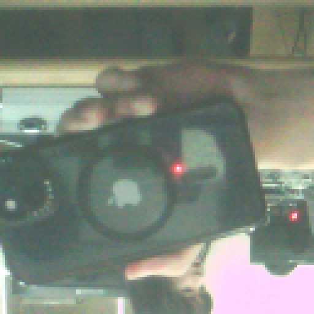

# 3단계: capture IP — ARM이 카메라 영상을 읽어 노트북으로 전송

직접 설계한 **AXI4-Lite capture IP**가 카메라 한 프레임을 **128×128 RGB**로 줄여 저장하고,
ARM이 그 영상을 AXI로 읽어 UART로 노트북에 보낸다. 노트북에서는 PNG로 저장한다 (CNN 학습 데이터 수집용).

- 보드: HUINS RPS-Z7020-TK (Zynq XC7Z020-CLG484-1), Vivado / SDK 2019.1
- 상태: **보드 동작 확인 완료 (2026-11-23)**

| 실제 캡처 (128×128, 4배 확대) |
|---|
|  |

---

## 구조

```
term_top.vhd
 ├─ system_wrapper (블록 디자인)
 │    ├─ ZYNQ7 PS : UART1(MIO 48/49), DDR 끔, M_AXI_GP0 켬, FCLK0 100 MHz
 │    ├─ AXI Interconnect, Processor System Reset
 │    └─ capture_0 (직접 만든 IP) ── AXI4-Lite @ 0x43C0_0000 (128 KB)
 │            ▲ pclk, pix_we, pix_addr, pix_data
 └─ camera_top ── 카메라 → BRAM → TFT (1단계 그대로)
         └ cap_we / cap_addr / cap_data : BRAM 쓰기 신호를 그대로 복사해서 capture IP로
```

### capture IP 동작
1. ARM이 CTRL 레지스터에 1을 쓰면 **다음 프레임**이 시작될 때(주소 0 픽셀) 캡처 시작
2. 480×272 화면의 **가운데 256×256** (x 112~367, y 8~263)만 사용
3. **2×2 픽셀 평균 → 128×128**, RGB565를 RGB888로 변환해 내부 BRAM(16,384 × 24bit)에 저장
4. 완료되면 CTRL의 done 비트가 1 → ARM이 픽셀을 읽음
- 카메라 클럭(PCLK, 약 24 MHz)과 AXI 클럭(100 MHz)이 달라서, 결과 메모리는 두 클럭 듀얼포트 BRAM, 제어 신호는 2~3단 동기화로 넘긴다.

### 레지스터 맵

| 주소 (base 0x43C0_0000) | 이름 | 설명 |
|---|---|---|
| `0x00000` | CTRL | W: bit0=1 캡처 시작 / R: bit0 done, bit1 busy, [31:16] 캡처 횟수 |
| `0x00004` | ID | R: `0xCA910002` |
| `0x00008` | INFO | R: `{128, 128}` (가로, 세로) |
| `0x10000 + 4*i` | PIXEL[i] | R: `0x00RRGGBB`, i = 0~16383 (행 우선) |

### 검증
- `sim/tb_capture.v`: 가짜 카메라 프레임(위치마다 색이 다른 패턴)을 넣고 AXI로 16,384픽셀 전부 읽어 기대값과 비교 → **0 mismatch**. 시작/완료 플래그, 두 번 연속 캡처도 확인.
- 구현: 타이밍 제약 모두 충족, BRAM 72/140 (51%), LUT 5%, 레지스터 6%.

---

## 폴더 구성

| 경로 | 내용 |
|---|---|
| `ip_repo/capture_1.0/hdl/capture_v1_0.v` | **capture IP (Verilog)** |
| `ip_repo/capture_1.0/component.xml`, `xgui/` | 패키징된 IP (`user.org:user:capture:1.0`) |
| `sim/tb_capture.v` | capture IP 테스트벤치 |
| `src/` | 2단계 소스 + 수정본 (`term_top.vhd`, `camera_top.vhd`에 cap_* 추가), `system_bd.tcl` |
| `sdk_src/main.c` | ARM 프로그램: UART 921,600bps, `c` 받으면 캡처 후 바이너리 전송 |
| `tools/capture_to_png.py` | 노트북 수신 스크립트 → PNG 저장 |
| `bitstream/` | `term_top.bit`, `term_top.hdf`, `ps7_init.tcl`, `capture_app.elf` (바로 실행 가능) |
| `package_ip.tcl` | IP 패키징 |
| `create_project.tcl` / `build.tcl` | 프로젝트 생성 / 비트스트림 빌드 |
| `build_sw.tcl` | ARM 프로그램 빌드 (SDK GUI 없이) |
| `program.tcl` / `run_capture.tcl` | FPGA 굽기 / 굽기+PS 초기화+프로그램 실행 |
| `docs/` | 예시 캡처 이미지 |

`vivado/`(프로젝트, 빌드 결과, SDK 워크스페이스)와 `captures/`(찍은 사진)는 저장소에 올리지 않는다.

---

## 실행 (빌드 없이)

1. 보드: 카메라 CAMERA1, **DIP SW1-1 ON**, JTAG, UART 연결 → **전원 껐다 켜기**
2. SDK Terminal, PuTTY 등 COM 포트를 잡는 프로그램은 닫기
3. 명령 프롬프트:
   ```bat
   cd C:\workspace_SoC\SoC_Term_project\stage3_capture
   C:\Xilinx\SDK\2019.1\bin\xsct.bat run_capture.tcl
   py -3 tools\capture_to_png.py --port COM23
   ```
   - `run_capture.tcl`은 **전원 켤 때마다 한 번만** (FPGA 다시 굽기 실패 방지)
   - `COM23`은 장치 관리자에서 확인한 UART 번호로
4. `captures\frame_XXXX.png` (128×128) 와 `frame_XXXX_x4.png` (512×512 확대본) 생성

### 학습 데이터 모으기
```bat
py -3 tools\capture_to_png.py --port COM23 --label scissors -n 50 --interval 0.5
```
→ `captures\scissors\scissors_0000.png ...` 50장. 장 사이 0.5초 동안 물건 위치를 바꿔가며 찍는다.

| 옵션 | 의미 |
|---|---|
| `--label 이름` | 클래스 이름 = 하위 폴더 |
| `-n 개수` | 찍을 장 수 |
| `--interval 초` | 장 사이 대기 |
| `--info` | IP 상태만 출력 |

- 한 장에 약 0.6초 (프레임 대기 + 49KB 전송).
- **ARM 프로그램이 UART를 921,600bps로 바꾼다.** 터미널 프로그램을 115,200으로 열면 글자가 깨진다.

---

## 다시 빌드하기
```bat
C:\Xilinx\Vivado\2019.1\bin\vivado.bat -mode batch -source package_ip.tcl     :: IP 수정했을 때
C:\Xilinx\Vivado\2019.1\bin\vivado.bat -mode batch -source create_project.tcl  :: vivado\stage3.xpr 생성
C:\Xilinx\Vivado\2019.1\bin\vivado.bat -mode batch -source build.tcl           :: bitstream\ 갱신
C:\Xilinx\SDK\2019.1\bin\xsct.bat build_sw.tcl                                 :: capture_app.elf 갱신
```
Vivado GUI로 보려면 `vivado\stage3.xpr`를 연다. SDK GUI로 하려면 Export Hardware → Launch SDK → Empty Application에 `sdk_src\main.c` 추가 (Debug 설정은 Reset entire system, Program FPGA 해제).

---

## CNN과의 관계
- **캡처는 128×128, CNN 입력은 32×32** (보드 메모리 OCM 약 256KB 때문. 최대 48×48 정도).
- 보드에서 추론할 때 ARM이 128×128을 **4×4 평균으로 32×32**로 줄여서 CNN에 넣는다. 학습할 때도 같은 방법으로 줄여야 한다.
- 원본을 128×128로 남겨두면 나중에 입력 크기를 바꾸거나 데이터 증강(위치를 옮겨 자르기)을 할 때 다시 찍을 필요가 없다.
